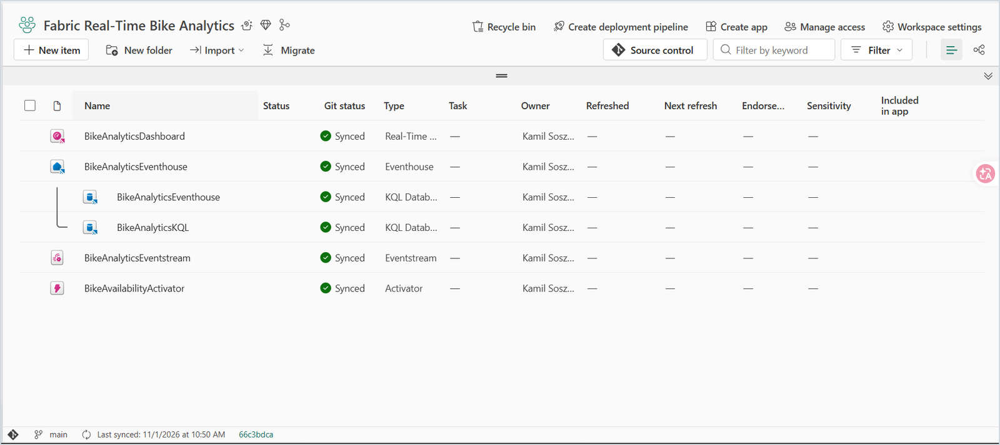
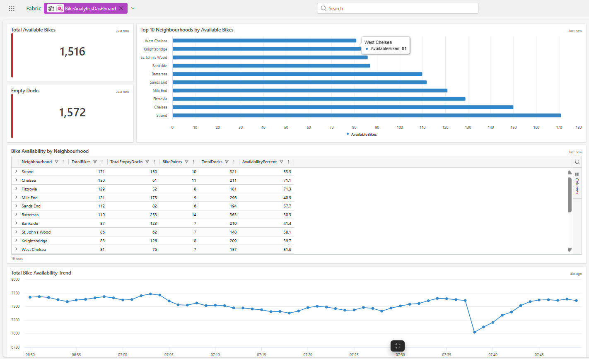

# Fabric Real-Time Bike Analytics

An end-to-end real-time analytics solution built with Microsoft Fabric Trial using the London Bike Share sample stream.

The project demonstrates real-time event ingestion, parallel stream processing, KQL analytics, operational monitoring, live visualization, state-transition alerting, data-quality validation, and GitHub source control.

## Solution overview

The solution continuously processes London Bike Share events through two independent data paths:

1. **Raw data path**
   - Preserves incoming bike-share events without transformation.
   - Writes source-aligned events to the `BikeShareRaw` KQL table.

2. **Minute aggregation path**
   - Groups events by `Neighbourhood`.
   - Calculates `SUM(No_Bikes)`.
   - Uses one-minute tumbling windows.
   - Writes aggregated results to the `BikeAvailabilityMinute` KQL table.

The persisted data supports latest-state operational analysis, neighbourhood availability monitoring, minute-level historical trends, threshold-crossing alerts, dashboard visualization, and independent data-quality validation.

## Project screenshots

### Microsoft Fabric workspace

The workspace contains the synchronized Real-Time Dashboard, Eventhouse, KQL databases, Eventstream, and Activator artifacts.



### Real-Time Dashboard

The operational dashboard presents exact live KPIs, neighbourhood rankings, availability details, and a time-filtered availability trend.



## Architecture

```text
London Bike Share Sample Stream
                |
                v
      BikeAnalyticsEventstream
                |
        +-------+------------------------------+
        |                                      |
        v                                      v
BikeAnalyticsDestination       GroupBikeAvailabilityByNeighbourhood
        |                                      |
        v                                      v
  BikeShareRaw                     BikeAvailabilityDestination
                                               |
                                               v
                                  BikeAvailabilityMinute
                |
                v
        BikeAnalyticsKQL
                |
        +-------+-------------------+
        |                           |
        v                           v
BikeAnalyticsDashboard   BikeAvailabilityActivator
                                    |
                                    v
                          Microsoft Teams action
```

## Microsoft Fabric components

| Component | Fabric item | Purpose |
|---|---|---|
| Workspace | `Fabric Real-Time Bike Analytics` | Hosts the complete real-time solution |
| Eventhouse | `BikeAnalyticsEventhouse` | Hosts the KQL databases |
| Operational KQL database | `BikeAnalyticsKQL` | Stores and exposes real-time analytical data |
| Eventstream | `BikeAnalyticsEventstream` | Ingests and processes London Bike Share events |
| Raw source | `BikeShareSource` | Microsoft Fabric sample-stream source |
| Raw destination | `BikeAnalyticsDestination` | Writes source events into the raw table |
| Stream operator | `GroupBikeAvailabilityByNeighbourhood` | Produces neighbourhood-level minute aggregations |
| Aggregated destination | `BikeAvailabilityDestination` | Writes minute results into the aggregated table |
| Raw table | `BikeShareRaw` | Stores source-aligned streaming events |
| Aggregated table | `BikeAvailabilityMinute` | Stores minute-level neighbourhood aggregations |
| KQL Queryset | `BikeAnalyticsKQL_queryset` | Contains validation and operational KQL queries |
| Real-Time Dashboard | `BikeAnalyticsDashboard` | Presents live operational metrics and trends |
| Activator | `BikeAvailabilityActivator` | Monitors threshold crossings and initiates Teams actions |

The Eventhouse also contains its default KQL database. The operational Eventstream destinations used by this project write to `BikeAnalyticsKQL`.

## Streaming transformation

`GroupBikeAvailabilityByNeighbourhood` uses the following configuration:

| Setting | Value |
|---|---|
| Aggregation | `SUM(No_Bikes)` |
| Output field | `TotalBikes` |
| Grouping field | `Neighbourhood` |
| Window type | `Tumbling` |
| Window duration | `1 minute` |
| Window offset | `0 seconds` |
| Window timestamp | `Window_End_Time` |

The output grain is one row per neighbourhood and completed minute window.

The resulting `BikeAvailabilityMinute` table contains `Neighbourhood`, `TotalBikes`, and `Window_End_Time`.

## Eventstream operational validation

The aggregated destination was validated with current Eventstream telemetry. The observed destination configuration included:

- workspace: `Fabric Real-Time Bike Analytics`
- Eventhouse: `BikeAnalyticsEventhouse`
- KQL database: `BikeAnalyticsKQL`
- destination table: `BikeAvailabilityMinute`
- input format: JSON
- event processing before ingestion: enabled

The observed runtime telemetry showed active live ingestion, zero backlogged input events, zero runtime errors, zero deserialization errors, zero data-conversion errors, and a maximum watermark delay of approximately one second.

## Data model and grains

### Raw event table

`BikeShareRaw` stores the historical stream of bike-point observations. Repeated `BikepointID` values are expected because each bike point produces multiple observations over time. `BikepointID` is therefore not a unique key across the complete raw history.

### Minute aggregation table

The logical key of `BikeAvailabilityMinute` is:

```text
Neighbourhood + Window_End_Time
```

The grain validation confirmed that every persisted key occurred exactly once, with no duplicated neighbourhood-window keys, no conflicting `TotalBikes` values for the same key, and a maximum of one record per key.

## Validated data-quality results

The following values were observed during the project audit on November 11, 2026. Counts continue to increase while the Eventstream remains active.

### Raw table results

| Metric | Validated result |
|---|---:|
| Raw rows observed | 8,595,090 |
| Distinct bike points | 120 |
| Distinct streets | 120 |
| Distinct neighbourhoods | 19 |
| Missing bike-point identifiers | 0 |
| Missing street names | 0 |
| Missing neighbourhood names | 0 |
| Missing latitude values | 0 |
| Missing longitude values | 0 |
| Invalid latitude values | 0 |
| Invalid longitude values | 0 |
| Missing bike counts | 0 |
| Negative bike counts | 0 |
| Minimum bike count | 0 |
| Maximum bike count | 46 |
| Missing empty-dock counts | 0 |
| Negative empty-dock counts | 0 |
| Minimum empty-dock count | 0 |
| Maximum empty-dock count | 42 |

The latest raw ingestion timestamp matched the audit execution period, confirming live ingestion.

### Minute table results

| Metric | Validated result |
|---|---:|
| Aggregated rows observed | 270,567 |
| Distinct neighbourhoods | 19 |
| Distinct minute windows | 14,037 |
| Missing neighbourhood names | 0 |
| Missing `TotalBikes` values | 0 |
| Negative `TotalBikes` values | 0 |
| Minimum `TotalBikes` | 16 |
| Maximum `TotalBikes` | 1,005 |
| Missing window timestamps | 0 |

The latest minute window and ingestion timestamp were approximately one minute behind the audit execution time, confirming current minute-level processing. Because the stream remained active during validation, subsequent queries returned higher row and window counts.

### Grain-validation results

| Metric | Result |
|---|---:|
| Total neighbourhood-window keys | 270,586 |
| Unique neighbourhood-window keys | 270,586 |
| Duplicated keys | 0 |
| Rows in duplicated keys | 0 |
| Maximum records per key | 1 |
| Keys with conflicting values | 0 |

The 19-row increase between consecutive audit queries represented one new complete minute window across 19 neighbourhoods.

## Stream-continuity validation

The complete minute-window history contained 14,243 observed minute windows, 14,242 complete windows, one partial window, and two completely missing windows.

| Window end time UTC | Result |
|---|---|
| `2026-11-08 02:46` | Complete: 19 neighbourhoods |
| `2026-11-08 02:47` | Partial: 7 neighbourhoods |
| `2026-11-08 02:48` | Missing |
| `2026-11-08 02:49` | Missing |
| `2026-11-08 02:50` | Complete: 19 neighbourhoods |

The exact root cause could not be determined from the retained data and available telemetry. The project documents the incident as a historical continuity limitation without assigning an unverified cause. No synthetic rows were added, and the incomplete historical period was not manually reconstructed.

## KQL validation examples

### Raw data validation

```kusto
BikeShareRaw
| summarize
    TotalRows = count(),
    DistinctBikepoints = dcount(BikepointID),
    DistinctStreets = dcount(Street),
    DistinctNeighbourhoods = dcount(Neighbourhood),
    MissingBikepointIDs = countif(isempty(BikepointID)),
    MissingStreets = countif(isempty(Street)),
    MissingNeighbourhoods = countif(isempty(Neighbourhood)),
    MissingLatitudes = countif(isnull(Latitude)),
    MissingLongitudes = countif(isnull(Longitude)),
    InvalidLatitudes = countif(Latitude < -90 or Latitude > 90),
    InvalidLongitudes = countif(Longitude < -180 or Longitude > 180),
    MissingBikeCounts = countif(isnull(No_Bikes)),
    NegativeBikeCounts = countif(No_Bikes < 0),
    MinimumBikeCount = min(No_Bikes),
    MaximumBikeCount = max(No_Bikes),
    MissingEmptyDockCounts = countif(isnull(No_Empty_Docks)),
    NegativeEmptyDockCounts = countif(No_Empty_Docks < 0),
    MinimumEmptyDockCount = min(No_Empty_Docks),
    MaximumEmptyDockCount = max(No_Empty_Docks),
    LatestIngestionTime = max(ingestion_time())
```

### Minute aggregation validation

```kusto
BikeAvailabilityMinute
| summarize
    TotalRows = count(),
    DistinctNeighbourhoods = dcount(Neighbourhood),
    DistinctTimeWindows = dcount(Window_End_Time),
    MissingNeighbourhoods = countif(isempty(Neighbourhood)),
    MissingTotalBikes = countif(isnull(TotalBikes)),
    NegativeTotalBikes = countif(TotalBikes < 0),
    MinimumTotalBikes = min(TotalBikes),
    MaximumTotalBikes = max(TotalBikes),
    MissingWindowEndTimes = countif(isnull(Window_End_Time)),
    FirstWindowEndTime = min(Window_End_Time),
    LatestWindowEndTime = max(Window_End_Time),
    LatestIngestionTime = max(ingestion_time())
```

### Grain validation

```kusto
BikeAvailabilityMinute
| summarize
    RecordsPerKey = count(),
    MinimumTotalBikes = min(TotalBikes),
    MaximumTotalBikes = max(TotalBikes),
    DistinctTotalBikeValues = dcount(TotalBikes),
    FirstIngestionTime = min(ingestion_time()),
    LatestIngestionTime = max(ingestion_time())
    by Neighbourhood, Window_End_Time
| summarize
    TotalGrainKeys = count(),
    UniqueGrainKeys = countif(RecordsPerKey == 1),
    DuplicatedGrainKeys = countif(RecordsPerKey > 1),
    RowsInDuplicatedKeys = sumif(RecordsPerKey, RecordsPerKey > 1),
    MaximumRecordsPerKey = max(RecordsPerKey),
    KeysWithConflictingValues = countif(
        RecordsPerKey > 1 and DistinctTotalBikeValues > 1
    )
```

### Window-completeness validation

```kusto
BikeAvailabilityMinute
| summarize
    NeighbourhoodsPerWindow = dcount(Neighbourhood),
    RowsPerWindow = count()
    by Window_End_Time
| summarize
    TotalWindows = count(),
    CompleteWindows = countif(
        NeighbourhoodsPerWindow == 19 and RowsPerWindow == 19
    ),
    IncompleteWindows = countif(
        NeighbourhoodsPerWindow != 19 or RowsPerWindow != 19
    ),
    MinimumNeighbourhoodsPerWindow = min(NeighbourhoodsPerWindow),
    MaximumNeighbourhoodsPerWindow = max(NeighbourhoodsPerWindow),
    MinimumRowsPerWindow = min(RowsPerWindow),
    MaximumRowsPerWindow = max(RowsPerWindow)
```

### Gap detection

```kusto
BikeAvailabilityMinute
| summarize
    RowsPerWindow = count(),
    NeighbourhoodsPerWindow = dcount(Neighbourhood),
    FirstIngestionTime = min(ingestion_time()),
    LatestIngestionTime = max(ingestion_time())
    by Window_End_Time
| order by Window_End_Time asc
| serialize
| extend PreviousWindowEndTime = prev(Window_End_Time)
| extend GapMinutes = datetime_diff(
    "minute",
    Window_End_Time,
    PreviousWindowEndTime
)
| where
    GapMinutes > 1
    or RowsPerWindow != 19
    or NeighbourhoodsPerWindow != 19
| project
    PreviousWindowEndTime,
    Window_End_Time,
    GapMinutes,
    MissingWindowCount = iff(
        isnull(PreviousWindowEndTime),
        long(null),
        GapMinutes - 1
    ),
    RowsPerWindow,
    NeighbourhoodsPerWindow,
    FirstIngestionTime,
    LatestIngestionTime
| order by Window_End_Time asc
```

### Latest operational snapshot

```kusto
BikeShareRaw
| summarize arg_max(ingestion_time(), *) by BikepointID
| summarize
    TotalBikes = sum(No_Bikes),
    TotalEmptyDocks = sum(No_Empty_Docks),
    BikePoints = dcount(BikepointID)
    by Neighbourhood
| extend TotalDocks = TotalBikes + TotalEmptyDocks
| extend AvailabilityPercent = round(
    100.0 * TotalBikes / TotalDocks,
    1
)
| order by TotalBikes desc
```

### Dashboard time-filtered trend

```kusto
BikeAvailabilityMinute
| where Window_End_Time between (_startTime .. _endTime)
| summarize
    TotalAvailableBikes = sum(TotalBikes)
    by Window_End_Time
| order by Window_End_Time asc
| render timechart
```

The default Real-Time Dashboard time parameter affects this visual only because the query explicitly uses `_startTime` and `_endTime`.

## Real-Time Dashboard

`BikeAnalyticsDashboard` provides five operational visuals:

1. `Total Available Bikes`
2. `Empty Docks`
3. `Top 10 Neighbourhoods by Available Bikes`
4. `Bike Availability by Neighbourhood`
5. `Total Bike Availability Trend`

The dashboard includes exact integer KPI values, live refresh, a default `Last 1 hour` time range, a trend connected to `_startTime` and `_endTime`, total-dock reconciliation, availability percentage, and latest-per-bikepoint snapshot logic using `arg_max(ingestion_time(), *)`.

The dashboard was validated in Viewing mode with active live refresh.

## Activator alert

`BikeAvailabilityActivator` contains the rule:

```text
Low Bike Availability Alert
```

The final runtime rule is:

| Setting | Value |
|---|---|
| Object | `Neighbourhood` |
| Monitored attribute | `TotalBikes` |
| Condition | `Decreases below` |
| Threshold | `50` |
| Occurrence | `Every time the condition is met` |
| Action | Microsoft Teams message |
| Message headline | `Low bike availability detected` |
| Context | `Neighbourhood`, `TotalBikes` |
| Runtime status | Running |

The transition condition detects:

```text
TotalBikes >= 50 -> TotalBikes < 50
```

This design avoids repeatedly activating the rule while a neighbourhood remains continuously below the threshold.

An earlier implementation used a persistent `Is less than 50` condition and generated excessive activations. The recipient was temporarily throttled by Fabric Activator. The rule was corrected to use a threshold-crossing condition.

Post-change observation confirmed that the rule remained running, repeated five-minute activation batches stopped, and a natural post-change activation was recorded. No artificial test action was used after the correction. Delivery of a new post-change Teams message was not independently confirmed during the observation period.

### Activator Git limitation

Microsoft Fabric Source control continued to show zero pending changes after the runtime condition was changed. The Fabric workspace contained the corrected running rule, but the runtime condition change was not surfaced as a new Git change.

After deployment or repository synchronization, verify or configure the Activator rule manually:

```text
Attribute: TotalBikes
Condition: Decreases below
Value: 50
Occurrence: Every time the condition is met
Action: Teams message
Context: Neighbourhood, TotalBikes
```

Do not assume that the synchronized Activator artifact alone guarantees reproduction of the final runtime rule configuration.

## Real-Time Hub

Real-Time Hub exposes and previews the streaming assets used by the solution, including `BikeAnalyticsEventstream-stream` and `BikeShareRaw`.

## Source control

The Microsoft Fabric workspace is connected to this GitHub repository through native Git integration. Fabric-managed artifacts include the Real-Time Dashboard, Eventhouse and KQL databases, Eventstream, and Activator.

The workspace is synchronized with the `main` branch. The audited dashboard improvements were committed with:

```text
Improve real-time dashboard KPIs and time filtering
```

Runtime Activator rule settings require separate verification because the final condition change did not appear as a pending Git modification.

## Prerequisites

Reproducing the project requires:

- a Microsoft Fabric tenant,
- active Fabric capacity or an eligible Fabric Trial,
- permission to create a Fabric workspace,
- access to Microsoft Fabric Real-Time Intelligence,
- permission to create Eventstream, Eventhouse, KQL Database, Real-Time Dashboard, and Activator items,
- a GitHub repository available for Fabric Git integration,
- permission to configure Microsoft Teams actions,
- access to the London Bike Share sample stream.

Connection credentials, recipients, and environment-specific settings are not stored in the repository.

## Reproduce the project

### 1. Create the workspace

Create a Microsoft Fabric workspace assigned to active Fabric capacity.

### 2. Connect source control

Connect the workspace to this repository and the `main` branch through Microsoft Fabric Git integration. Synchronize the supported Fabric artifacts.

### 3. Verify Eventhouse and KQL Database

Open `BikeAnalyticsEventhouse`. Confirm that `BikeAnalyticsKQL` exists and contains or can receive:

```text
BikeShareRaw
BikeAvailabilityMinute
```

### 4. Verify the Eventstream

Open `BikeAnalyticsEventstream` and confirm:

- source: `BikeShareSource`,
- raw destination: `BikeAnalyticsDestination`,
- raw table: `BikeShareRaw`,
- aggregation operator: `GroupBikeAvailabilityByNeighbourhood`,
- aggregation: `SUM(No_Bikes)`,
- grouping: `Neighbourhood`,
- window: one-minute tumbling,
- offset: zero seconds,
- aggregated destination: `BikeAvailabilityDestination`,
- aggregated table: `BikeAvailabilityMinute`.

Activate the Eventstream when all connections and mappings are correct.

### 5. Validate persisted data

Run the KQL validation queries documented in this README. Confirm that source rows are being ingested, 19 neighbourhoods are represented, required fields are populated, coordinate ranges are valid, operational values are nonnegative, the minute-table grain is unique, and current ingestion timestamps are recent.

### 6. Verify the Real-Time Dashboard

Open `BikeAnalyticsDashboard` and confirm:

- live refresh is enabled,
- KPI values are displayed as full integers,
- `Empty Docks` is not truncated,
- the table contains 19 neighbourhoods,
- the trend uses `_startTime` and `_endTime`,
- `Last 1 hour` restricts the trend to approximately the latest 60 minute windows.

### 7. Verify the Activator rule

Open `BikeAvailabilityActivator` and manually verify or configure:

```text
Attribute: TotalBikes
Condition: Decreases below
Value: 50
Occurrence: Every time the condition is met
Action: Teams message
Context: Neighbourhood, TotalBikes
```

Confirm that the intended recipient is authorized to receive Fabric Activator messages. Avoid repeated test actions if the recipient has previously been throttled.

### 8. Verify Git synchronization

Return to the workspace and confirm that Source control shows zero pending changes, supported artifacts show `Synced`, and the workspace is connected to `main`.

## Trial and platform considerations

The project was built in Microsoft Fabric Trial using built-in sample data.

A classic Power BI workspace app was not created because the primary visualization is a Real-Time Dashboard, which is shared directly. A separate Power BI report was intentionally not added because it would duplicate the operational analytics already provided by the Real-Time Dashboard.

## Known limitations

- Streaming row and window counts continue to increase while the Eventstream is active.
- The retained history contains one confirmed continuity incident consisting of one partial window and two missing windows.
- The exact cause of the historical continuity incident could not be verified from retained telemetry.
- Missing historical windows were not reconstructed with synthetic data.
- Microsoft Teams delivery depends on recipient availability and Fabric Activator throttling controls.
- A previously noisy alert definition caused recipient throttling.
- The corrected Activator rule uses `Decreases below 50`.
- Delivery of a new Teams message after the final rule correction was not independently confirmed during the observation period.
- The final runtime Activator condition did not appear as a pending Git modification.
- Activator runtime settings must be verified manually after deployment.
- Environment-specific connections, recipients, and credentials are not stored in Git.
- The project does not implement automatic backfilling for missing streaming windows.
- Deployment pipelines and automated CI/CD tests are outside the current project scope.

## Skills demonstrated

- Microsoft Fabric
- Microsoft Fabric Real-Time Intelligence
- Real-Time Hub
- Eventstream ingestion
- no-code stream processing
- Eventhouse
- KQL Database
- KQL Queryset
- Kusto Query Language
- streaming data-quality validation
- minute-window validation
- real-time operational monitoring
- Real-Time Dashboard development
- dashboard parameters
- Activator state-transition rules
- Microsoft Teams actions
- Git integration
- GitHub source control
- technical documentation
- incident and limitation documentation

## Repository structure

```text
.
├── BikeAnalyticsDashboard.KQLDashboard/
├── BikeAnalyticsEventhouse.Eventhouse/
├── BikeAnalyticsEventstream.Eventstream/
├── BikeAvailabilityActivator.Reflex/
├── LICENSE
├── README.md
├── real-time-dashboard.png
└── workspace-overview.png
```

## Project status

The following components are operational and audited:

- real-time ingestion,
- raw event storage,
- one-minute stream aggregation,
- KQL data validation,
- grain and duplicate validation,
- latest-state operational queries,
- Real-Time Dashboard,
- live time filtering,
- Activator threshold-crossing logic,
- workspace access control,
- GitHub source control.

The project remains under active development and can be updated as Microsoft Fabric introduces new Real-Time Intelligence capabilities and recommended practices.

## License

This project is licensed under the terms of the [MIT License](LICENSE).
